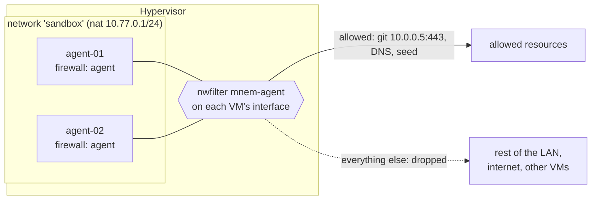

# Networks and firewalls

[← README](../README.md)

- [Why](#why)
- [A sandbox in one group](#a-sandbox-in-one-group)
- [Networks](#networks)
- [Firewalls](#firewalls)
- [How a VM on a new network gets configured](#how-a-vm-on-a-new-network-gets-configured)
- [Changing things later](#changing-things-later)
- [Ownership and deletion](#ownership-and-deletion)
- [Recipes](#recipes)
- [Limits](#limits)

## Why

A VM that runs code you do not fully trust — an AI agent with a shell, a CI runner, a scraper, a
build of somebody else's project — should reach what it needs and nothing else. Doing that inside
the guest does not hold: whatever runs there as root can flush its own iptables. Mnemosyne puts the
boundary on the hypervisor instead:

- **`networks`** — libvirt networks declared in the inventory: a private NAT subnet for the
  sandbox, an isolated lab, or the host's LAN bridge. Created before any VM, so a VM can be put on a
  network declared in the same run.
- **`firewalls`** — named rule sets, applied to one VM or many with `firewall:`. Each becomes a
  libvirt network filter (nwfilter) on the VM's interface, enforced by the hypervisor's
  ebtables/iptables, outside the guest.



## A sandbox in one group

```yaml
- group: "hv01.example.lan"
  host: "192.0.2.10"
  user: "virtops"
  port: 22
  key: "/home/virtops/.ssh/id_ed25519"
  volLookup: "debian-13-genericcloud-amd64.qcow2"
  metaUrl: "http://192.0.2.5:8080/cloud-init/"

  networks:
    sandbox:                      # libvirt network name
      mode: nat                   # nat | route | isolated | bridge
      address: 10.77.0.1/24       # the host's address on it = the guests' gateway

  firewalls:
    agent:                        # becomes nwfilter 'mnem-agent'
      default: drop               # anything no rule accepts is dropped (the default)
      rules:
        - action: accept
          direction: in           # traffic TO the VM
          protocol: tcp
          remote: 10.77.0.1       # only the hypervisor may ssh in
          ports: 22
        - action: accept
          direction: out          # traffic FROM the VM
          protocol: udp
          remote: [8.8.8.8, 1.1.1.1]
          ports: 53
          comment: dns
        - action: accept
          direction: out
          protocol: tcp
          remote: 10.0.0.5        # the internal git server, nothing else on the LAN
          ports: [22, 443]
        - action: reject          # the rest of the private ranges is off limits...
          direction: out          # (the first match wins, so this sits below the git
          remote: [10.0.0.0/8, 172.16.0.0/12, 192.168.0.0/16]   # rule and above the next one)
        - action: accept
          direction: out
          protocol: tcp
          ports: 443              # ...and https to anywhere else, i.e. the internet, is allowed

  firewall: agent                 # optional: every server of the group gets it...

  servers:
    agent-01:
      cpu: 2
      ram: 4096
      ip: 10.77.0.10/24           # gateway defaults to 10.77.0.1 on a nat/route network
      network: sandbox
    agent-02:
      cpu: 2
      ram: 4096
      ip: 10.77.0.11/24
      network: sandbox
    builder:
      cpu: 4
      ram: 8192
      ip: 10.77.0.20/24
      network: sandbox
      firewall: none              # ...unless it opts out
```

The plan shows the networks and firewalls in a block of their own, before the VMs:

```
[ hv01.example.lan · networks ]  create: 2
  + network sandbox  (nat 10.77.0.1/24)
  + firewall agent  (default drop, 5 rules, anti-spoofing, seed allowed, dhcp allowed)
      accept in tcp from 10.77.0.1 port 22
      accept out udp to 8.8.8.8,1.1.1.1 port 53  # dns
      accept out tcp to 10.0.0.5 port 22,443
      ...

[ hv01.example.lan ]  create: 3
  + agent-01
  + agent-02
  + builder
```

## Networks

| Field | Default | Notes |
| --- | --- | --- |
| map key | required | The libvirt network name: 1-50 letters, digits, `_`, `.`, `-`. |
| `mode` | `nat` | See below. |
| `address` | required, except `bridge` | The host's address on the bridge with the subnet's prefix, `10.77.0.1/24`. The guests' gateway in `nat` and `route` mode. Must not overlap another declared network or one already on the host. |
| `bridge` | libvirt picks `virbrN` | Linux bridge name, at most 15 characters. **Required** for `bridge` mode, where it names the existing host bridge. |
| `dhcp` | none | Optional pool for VMs Mnemosyne did not create, `10.77.0.100-10.77.0.199`. Mnemosyne's own VMs never need it — see [below](#how-a-vm-on-a-new-network-gets-configured). |
| `autostart` | `true` | Start the network when the hypervisor boots. |

| Mode | What the guests can reach | Typical use |
| --- | --- | --- |
| `nat` | Everything the hypervisor can, masqueraded behind its address. Nothing outside can open a connection to them. | A sandbox: pair it with a firewall that says which of "everything" is allowed. |
| `route` | Same, routed instead of masqueraded: the rest of the network needs a route to `address`. | Guests that must be addressable from the LAN by their own IPs. |
| `isolated` | Each other and the host's own address on the bridge, nothing beyond. | A closed lab. The seed server must be on the hypervisor itself (`metaUrl` inside the subnet), or the guests are never configured — the inventory is refused otherwise. |
| `bridge` | The host's LAN directly, as if plugged into the switch. | Guests that are ordinary LAN hosts. No `address`, no DHCP of Mnemosyne's: the LAN's own DHCP serves the first boot. |

A server's `ip` must be inside its declared network's subnet, and not the network's own address.

## Firewalls

| Field | Default | Notes |
| --- | --- | --- |
| map key | required | 1-41 characters of `a-z`, `0-9`, `_`, `.`, `-`. The nwfilter is called `mnem-<key>`. |
| `default` | `drop` | What happens to traffic no rule matched: `drop` (an allow-list, the usual) or `accept` (a deny-list). |
| `antiSpoofing` | `true` | Includes libvirt's `clean-traffic`: the VM can send only from its own MAC and its inventory `ip`, and cannot spoof ARP. |
| `allowSeed` | `true` | Always lets the VM reach its cloud-init seed server (`metaUrl` host and port). Without it a VM behind `default: drop` is never configured. |
| `allowDhcp` | `true` | Lets the VM get its first-boot lease ([why](#how-a-vm-on-a-new-network-gets-configured)). |
| `rules` | none | Up to 500, checked **in order: the first that matches decides**. |

Group-level `firewall:` names the firewall of every server that has none of its own; a server
writes `firewall: none` to opt out. A server without a firewall keeps whatever filter was put on
its interface by hand — only `mnem-*` filters are ever replaced or removed.

### Rules

| Field | Default | Notes |
| --- | --- | --- |
| `action` | required | `accept`, `drop`, or `reject` (refused with an ICMP error, so the guest fails fast instead of timing out). |
| `direction` | required | `out`: the VM sends, i.e. connections it opens. `in`: traffic to the VM. |
| `protocol` | `all` | `tcp`, `udp`, `icmp` or `all`. |
| `remote` | any | The other end — destination of `out`, source of `in`: an address or a CIDR block, one or a list. |
| `ports` | any | Destination port: the remote service for `out`, the VM's own listening port for `in`. `443` or `8000-8100`, one or a list. Only with `tcp` or `udp`. |
| `comment` | none | Shown in the plan and written into the iptables rule. |

A rule only ever describes who **opens** a connection: replies to anything accepted are let back
in automatically (connection tracking), so "accept out tcp 443" is all an HTTPS client needs.
`remote` × `ports` expand into one nwfilter rule each.

### What the filter is made of

For reference, `mnem-<name>` is built in this order, lowest nwfilter priority first:

| Priority | Rule |
| --- | --- |
| chains -800…-500 | `clean-traffic` (with `antiSpoofing`) |
| -300 | accept `ESTABLISHED,RELATED`, both directions |
| -260 | accept DHCP, udp 68→67 out and 67→68 in (with `allowDhcp`) |
| -250 | accept tcp out to `$MNEM_SEED_IP:$MNEM_SEED_PORT` (with `allowSeed`) |
| -200 … | your `rules`, in order |
| 900, 901 | drop all IPv4 and all IPv6, both directions (with `default: drop`) |

Nothing in it is VM-specific. The VM's address and its seed server come in as parameters of the
`<filterref>` on its interface (`IP`, `MNEM_SEED_IP`, `MNEM_SEED_PORT`), which is how one filter
serves every VM that names it. A `metaUrl` given as a host name is resolved once, when the
inventory is loaded.

## How a VM on a new network gets configured

cloud-init fetches its seed over HTTP **before** it has applied the static address from
`network-config` — it first brings the interface up with DHCP. On the host's LAN the router
answers; on a network Mnemosyne creates, nobody would, and a DHCP address from a pool would not be
the inventory `ip` that anti-spoofing pins the VM to.

So for every VM on a network declared in `networks`, Mnemosyne:

1. gives the VM's interface a MAC derived from its server id (`52:54:00:xx:xx:xx`, the same on
   every run);
2. reserves the inventory `ip` for that MAC in the network's DHCP, live and in the config
   (`virNetworkUpdate`; dnsmasq is reloaded, the network is not restarted);
3. defines and boots the VM, which gets exactly its own address, fetches the seed through the
   firewall's DHCP and seed rules, and is then configured statically by cloud-init.

The reservation is taken back when the VM is deleted. Two server ids deriving the same MAC on one
group are refused at validation.

## Changing things later

| Change | What happens |
| --- | --- |
| A firewall's rules | The filter is redefined; libvirt re-applies it **live** to every running VM that uses it. The plan names them: `applies live to agent-01, agent-02`. |
| A server's `firewall` (set, swap, `none`) | The interface's `<filterref>` is updated in the persistent config and, if the VM runs, live. No restart. |
| A server's `ip` | Its filter parameters follow (`firewall agent parameters`). The guest's own address is cloud-init's and is not changed on an existing VM. |
| A network's `address`, `bridge`, `dhcp`, `mode` | The config is redefined, DHCP reservations carried over. With no running guest on it the network is restarted at once; with running guests it is **not** — a restart cuts them off — and the report says so: `restart the network yourself to apply: virsh net-destroy sandbox && virsh net-start sandbox`. |
| A network's `autostart`, or a network that is stopped | Set / started. |
| A server's `network` | Not moved: the plan notes it (`network 'a' on the host, 'b' in the inventory - not moved`). |

Every run diffs the filters and networks against what libvirt reports, so a second run with the same
inventory prints no `networks` block at all.

## Ownership and deletion

- A network is Mnemosyne's when its libvirt metadata carries `<mnem:managedBy>mnemosyne`; a filter
  when its name starts with `mnem-`. Nothing else is ever changed or deleted. Keep the `mnem-`
  prefix for Mnemosyne.
- Declaring a network whose name an **unmanaged** network already holds blocks the run instead of
  taking it over (`name taken by a network mnemosyne does not manage`). To put VMs on an existing
  network such as `host-bridge`, do not declare it — just name it in the server's `network`.
- A managed network or filter that leaves the inventory is deleted, after the VMs, once nothing uses
  it. "Uses" is counted as the host will be after this run: a VM deleted in the same run does not
  hold its network, a VM moved off a firewall does not hold the filter. One that is still in use is
  kept and noted (`not in the inventory, still used by agent-01 - kept`). `--no-delete` keeps them
  all.

## Recipes

**An agent that may use one internal API and the internet over HTTPS, nothing else on the LAN.**

```yaml
firewalls:
  agent:
    rules:
      - {action: accept, direction: in,  protocol: tcp, remote: 10.77.0.1, ports: 22}
      - {action: accept, direction: out, protocol: udp, remote: [8.8.8.8, 1.1.1.1], ports: 53}
      - {action: accept, direction: out, protocol: tcp, remote: 10.0.0.5, ports: 443}
      - {action: reject, direction: out, remote: [10.0.0.0/8, 172.16.0.0/12, 192.168.0.0/16, 169.254.0.0/16]}
      - {action: accept, direction: out, protocol: tcp, ports: [80, 443]}
```

**Only the local network, no internet.**

```yaml
firewalls:
  lan-only:
    rules:
      - {action: accept, direction: out, remote: 192.168.17.0/24}
      - {action: accept, direction: in,  remote: 192.168.17.0/24}
```

**Block a few things, allow the rest** (`default: accept`).

```yaml
firewalls:
  no-lan-admin:
    default: accept
    rules:
      - {action: reject, direction: out, protocol: tcp, remote: 192.168.17.0/24, ports: [22, 3389, 5900-5910]}
```

**VMs on the host's LAN, firewalled the same way.** Firewalls work on any network, declared or not:

```yaml
servers:
  web-01:
    network: host-bridge     # an existing libvirt network, not declared here
    ip: 192.168.17.40/24
    gateway: 192.168.17.1
    firewall: agent
```

## Limits

- Rules are IPv4. With `default: drop`, IPv6 is dropped entirely.
- `remote` takes addresses and CIDR blocks, not host names: a firewall that resolved names would be
  as good as the DNS it asked, at the moment it asked.
- The host needs libvirt's nwfilter driver (`libvirt-daemon-driver-nwfilter`, part of the usual
  `libvirt-daemon-system`). Without it a run that declares a firewall stops in preflight.
- `cloud-init` packages: a VM behind `default: drop` installs nothing from the internet on its first
  boot unless the firewall lets it reach a mirror and DNS. The shipped `user-data.yml` installs
  packages; trim it, or allow the mirror.
- Network changes under running guests wait for a manual network restart (above); Mnemosyne never
  cuts guests off on its own.
